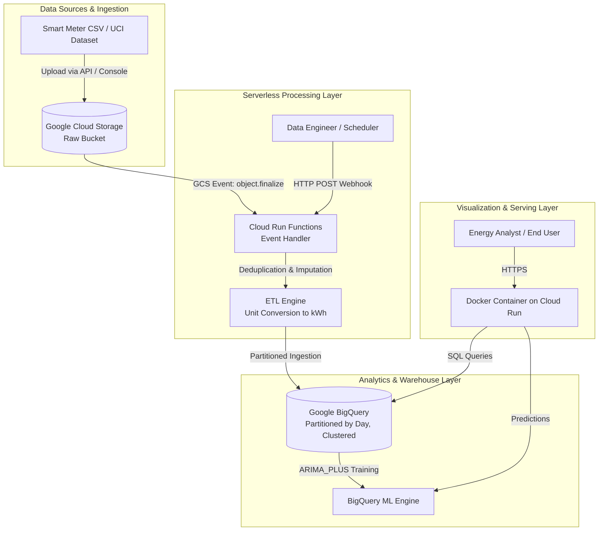

# EnergyPulse Cloud: System Architecture & Cloud Engineering Design

## 1. System Overview

**EnergyPulse Cloud** is an enterprise-grade academic cloud data analytics and time-series forecasting system engineered on Google Cloud Platform (GCP). The system automates ingestion of smart-meter electricity measurements, processes data through a serverless ETL pipeline, manages an analytical warehouse in Google BigQuery, performs chronological predictive forecasting, detects anomalies, and visualizes insights in a modern Streamlit application.

---

## 2. End-to-End Cloud Architecture

---

## 3. Component Breakdown

### 3.1 Raw Storage Layer (Google Cloud Storage)
- **Bucket**: `gs://energypulse-raw-data-bucket`
- **Storage Class**: Standard (with lifecycle rule transitioning archives older than 90 days to Coldline).
- **Security**: Uniform bucket-level access enabled; public read access disabled.

### 3.2 Serverless Processing (Cloud Run Functions)
- **Runtime**: Python 3.11
- **Event Trigger**: `google.cloud.storage.object.v1.finalized`
- **Processing Flow**:
  1. Validates incoming file against strict schema.
  2. Resolves timestamp syntax into ISO UTC timestamps.
  3. Replaces `?` indicators with NaN and applies linear interpolation.
  4. Aggregates minute readings into hourly kilowatt-hour (kWh) intervals.
  5. Extracts temporal feature vectors (hour, day of week, peak indicators).
  6. Idempotently loads rows into BigQuery.

### 3.3 Analytical Data Warehouse (Google BigQuery)
- **Dataset**: `energypulse_analytics`
- **Table**: `household_hourly_consumption`
- **Partitioning**: Partitioned by `DATE(timestamp)` to optimize scan costs and ensure queries only scan requested time horizons.
- **Clustering**: Clustered by `is_peak_period, hour` for fast temporal slice filtering.

### 3.4 Machine Learning & Forecasting
- **Cloud Managed**: BigQuery ML `ARIMA_PLUS` with automated seasonality detection and French holiday calendars.
- **Local / Container Baseline**: Chronological Ridge and Random Forest regressors benchmarked against a 24-hour persistence lag model ($t-24$).

### 3.5 Interactive Serving Application (Streamlit on Cloud Run)
- **Container**: Minimal `python:3.11-slim` Docker image running Streamlit on port `8080`.
- **Modes**:
  - `DEMO_MODE=True`: Zero-cost execution with local SQLite simulation and synthetic benchmark datasets.
  - `DEMO_MODE=False`: Connects to live BigQuery and Cloud Storage via Google Application Default Credentials.

---

## 4. Security & Identity Management

1. **Authentication**: All deployment workflows utilize **Workload Identity Federation (WIF)**, eliminating hardcoded JSON service account keys.
2. **Principle of Least Privilege (PoLP)**:
   - Cloud Run Function service account granted `roles/storage.objectViewer` and `roles/bigquery.dataEditor`.
   - Dashboard service account granted `roles/bigquery.dataViewer` and `roles/bigquery.jobUser`.
3. **Environment Separation**: Parameterized through environment variables (`DEMO_MODE`, `GCP_PROJECT_ID`, `BQ_DATASET_ID`).
